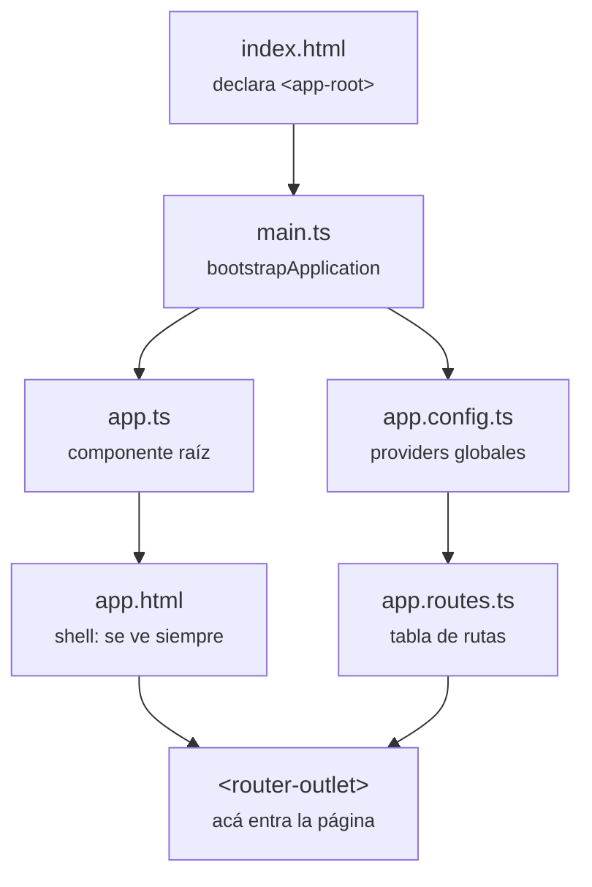

# Programación IV — práctica de cursada
Un proyecto Angular por clase, más los apuntes conceptuales de cada una.
**Programación IV · División 341 · UTN FRA · 2026 C2 · Prof. Agustín Friadenrich**

## Estructura

```
prog4-practica-utn/
├── .nvmrc                 Versión de Node del repositorio
├── .github/workflows/     CI
├── apuntes/               Conceptos y diagramas, sin código de app
├── clase-01/              Proyecto Angular autónomo
└── clase-02/              ...
```

## Apuntes

`apuntes/` se lee, `clase-XX/` se ejecuta. Cada `clase-XX` tiene su propio `package.json` y sus dependencias.

## Trabajar en una clase

```bash
cd clase-01
nvm use
npm ci
npm start        # http://localhost:4200
```

| Script                 | Qué hace                            |
| ---------------------- | ----------------------------------- |
| `npm start`            | Servidor de desarrollo              |
| `npm run build`        | Build de producción a `dist/`       |
| `npm test`             | Tests en modo watch                 |
| `npm run test:ci`      | Tests una sola vez                  |
| `npm run lint`         | ESLint sobre TypeScript y templates |
| `npm run format`       | Prettier reescribe                  |
| `npm run format:check` | Prettier sólo verifica              |

## Stack

| Pieza      | Versión                  |
| ---------- | ------------------------ |
| Angular    | 22.1.x                   |
| Node       | 24 (LTS)                 |
| TypeScript | 6.0                      |
| Vitest     | 4.x                      |
| ESLint     | 10 + `angular-eslint` 22 |
| Prettier   | 3.8                      |

## Arquitectura

Angular 22 no usa `NgModule`. Cadena de arranque:



Carpetas dentro de cada proyecto:

```
src/app/
├── app.ts / app.html / app.css    Shell
├── app.config.ts                  Providers globales
├── app.routes.ts                  Tabla de rutas
├── pages/                         Un componente por ruta
├── componentes/                   Piezas reutilizables
├── services/                      (desde la clase 03)
└── interfaces/                    (desde la clase 03)
```

En `pages/` va lo que tiene URL propia; en `componentes/`, lo reutilizable.

## CI/CD

- **GitHub Actions** ([`ci.yml`](.github/workflows/ci.yml)): lint, formato, tests y build en cada push y pull request. Detecta las carpetas con `angular.json` y corre una verificación por cada una, en paralelo y sin  `fail-fast`. Agregar una clase no requiere tocar el workflow.
- **Vercel**: deploy. Preview por rama, producción en `main`.

## Clases

| Clase | Fecha      | Temas                                                             | Proyecto              | Apunte                             |
| ----- | ---------- | ----------------------------------------------------------------- | --------------------- | ---------------------------------- |
| 01    | 18/08/2026 | Angular, CLI, componentes, binding, ruteo                          | [clase-01](clase-01/) | [clase-01.md](apuntes/clase-01.md) |
| 02    | 20/08/2026 | Lazy loading, rutas hijas, ciclo de vida, bindeos, signals          | [clase-02](clase-02/) | [clase-02.md](apuntes/clase-02.md) |

## Material de la cátedra

- [Repositorio 2026 C2](https://github.com/afriadenrich/programacion-iv-2026-c2)
- [Repositorio 2026 C1](https://github.com/afriadenrich/programacion-iv-2026-c1) — completo, un ejemplo por tema
- [angular.dev](https://angular.dev)
