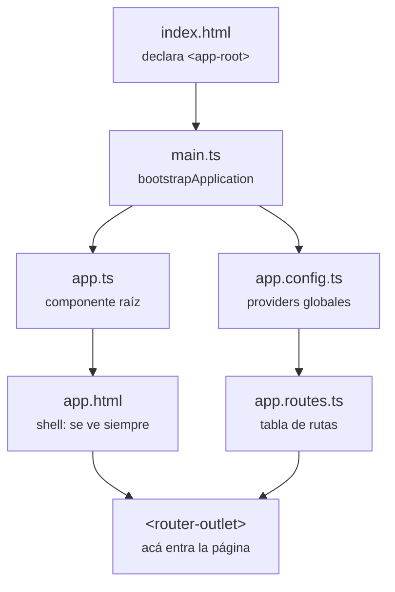

# Programación IV — práctica de cursada
Un apunte y un proyecto que corre, por cada clase.
**Programación IV · División 341 · UTN FRA · 2026 C2 · Prof. Agustín Friadenrich**

## Estructura

Una carpeta por clase. Adentro, el apunte por un lado y el código por el otro:

```
prog4-practica-utn/
├── .nvmrc                       Versión de Node del repositorio
├── .github/workflows/           CI
├── clase-01-intro/
│   ├── clase-apunte/            Apunte, resúmenes y material adicional
│   └── clase-proyecto/          Proyecto autónomo: compila y corre solo
├── clase-02-ruteo/
└── ...
```

## Trabajar en una clase

Cada `clase-proyecto/` tiene su propio `package.json` y sus dependencias, y un README con qué mirar.

```bash
cd clase-01-intro/clase-proyecto
nvm use
npm ci
npm start        # http://localhost:4200
```

| Script                 | Qué hace                            |
| ---------------------- | ----------------------------------- |
| `npm start`            | Servidor de desarrollo              |
| `npm run build`        | Build de producción a `dist/`       |
| `npm test`             | Tests en modo watch                 |
| `npm run test:ci`      | Tests una sola vez                  |
| `npm run lint`         | ESLint sobre TypeScript y templates |
| `npm run format`       | Prettier reescribe                  |
| `npm run format:check` | Prettier sólo verifica              |

## Stack

| Pieza      | Versión                  |
| ---------- | ------------------------ |
| Angular    | 22.1.x                   |
| Node       | 24 (LTS)                 |
| TypeScript | 6.0                      |
| Vitest     | 4.x                      |
| ESLint     | 10 + `angular-eslint` 22 |
| Prettier   | 3.8                      |

## Arquitectura

Angular 22 no usa `NgModule`. Cadena de arranque:



Carpetas dentro de cada proyecto:

```
src/app/
├── app.ts / app.html / app.css    Shell
├── app.config.ts                  Providers globales
├── app.routes.ts                  Tabla de rutas
├── pages/                         Un componente por ruta
├── componentes/                   Piezas reutilizables
├── services/                      (desde la clase 03)
└── interfaces/                    (desde la clase 03)
```

En `pages/` va lo que tiene URL propia; en `componentes/`, lo reutilizable.

## CI/CD

- **GitHub Actions** ([`ci.yml`](.github/workflows/ci.yml)): lint, formato, tests y build en cada push y pull request. Detecta las carpetas con `angular.json` y corre una verificación por cada una, en paralelo y sin  `fail-fast`. Agregar una clase no requiere tocar el workflow.
- **Vercel**: deploy. Preview por rama, producción en `main`.

Cada `clase-proyecto/` de Angular necesita los scripts `lint`, `format:check`, `test:ci` y `build`, o el workflow falla al no encontrarlos. Copiando la clase anterior vienen incluidos; arrancando con `ng new` hay que agregarlos y correr `ng add angular-eslint`.

## Clases

| Clase | Fecha | Temas | Apunte | Proyecto |
| ----- | ----- | ----- | ------ | -------- |
| 01 | 18/08/2026 | Angular, CLI, componentes, binding, ruteo | [apunte](clase-01-intro/clase-apunte/apunte.md) | [proyecto](clase-01-intro/clase-proyecto/) |
| 02 | 20/08/2026 | Lazy loading, rutas hijas, ciclo de vida, bindeos, signals | [apunte](clase-02-ruteo/clase-apunte/apunte.md) | [proyecto](clase-02-ruteo/clase-proyecto/) |
| 03 | 25/08/2026 | Input, output, servicios, HttpClient | [apunte](clase-03-servicios/clase-apunte/apunte.md) | [proyecto](clase-03-servicios/clase-proyecto/) |
| 04 | 27/08/2026 | Formularios reactivos, validaciones propias, FormArray | [apunte](clase-04-formularios/clase-apunte/apunte.md) | [proyecto](clase-04-formularios/clase-proyecto/) |
| 05 | 01/09/2026 | Supabase, auth, guards | [apunte](clase-05-auth/clase-apunte/apunte.md) | [proyecto](clase-05-auth/clase-proyecto/) |
| 06 | 03/09/2026 | Supabase Database, RLS y Realtime | [apunte](clase-06-db-realtime/clase-apunte/apunte.md) | [proyecto](clase-06-db-realtime/clase-proyecto/) |
| 07 | 08/09/2026 | Supabase Storage | [apunte](clase-07-storage/clase-apunte/apunte.md) | [proyecto](clase-07-storage/clase-proyecto/) |
| 08 | 10/09/2026 | Pipes, directivas y deploy | [apunte](clase-08-pipes-directivas/clase-apunte/apunte.md) | [proyecto](clase-08-pipes-directivas/clase-proyecto/) |
| 09 | 15/09/2026 | PWA, Service Worker e interceptors | [apunte](clase-09-pwa-interceptors/clase-apunte/apunte.md) | [proyecto](clase-09-pwa-interceptors/clase-proyecto/) |
| 10 | 22/09/2026 | Notificaciones push y Edge Functions | [apunte](clase-10-notificaciones/clase-apunte/apunte.md) | [proyecto](clase-10-notificaciones/clase-proyecto/) |
| 11 | 29/09/2026 | Programar mejor con IA | [apunte](clase-11-ia/clase-apunte/apunte.md) | [proyecto](clase-11-ia/clase-proyecto/) |
| 12 | 13/10/2026 | NestJS | [apunte](clase-12-nest/clase-apunte/apunte.md) | [proyecto](clase-12-nest/clase-proyecto/) |
| 13 | 15/10/2026 | Mongoose | [apunte](clase-13-mongo/clase-apunte/apunte.md) | [proyecto](clase-13-mongo/clase-proyecto/) |
| 14 | 20/10/2026 | JWT | [apunte](clase-14-jwt/clase-apunte/apunte.md) | [proyecto](clase-14-jwt/clase-proyecto/) |
| 15 | 27/10/2026 | Fullstack, deploy, cookies, TTL y caché | [apunte](clase-15-cookies-ttl/clase-apunte/apunte.md) | [proyecto](clase-15-cookies-ttl/clase-proyecto/) |
| 16 | 29/10/2026 | Storage externo (Cloudinary), interceptors, health y logger | [apunte](clase-16-storage-externo/clase-apunte/apunte.md) | [proyecto](clase-16-storage-externo/clase-proyecto/) |

Referencias aparte: [comandos del CLI](clase-01-intro/clase-apunte/cli-angular.md) · [API de Rick and Morty](clase-03-servicios/clase-apunte/api-rick-and-morty.md) · [Supabase](clase-05-auth/clase-apunte/supabase.md).

## Material de la cátedra

- [Repositorio 2026 C2](https://github.com/afriadenrich/programacion-iv-2026-c2)
- [Repositorio 2026 C1](https://github.com/afriadenrich/programacion-iv-2026-c1) — completo, un ejemplo por tema
- [angular.dev](https://angular.dev)
