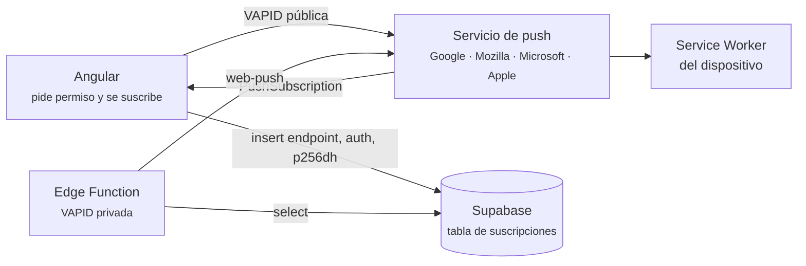

# Clase 10 — Notificaciones push con Service Worker y Edge Functions

**Fecha:** 22/09/2026 (video subido 23/09/2026) · **Angular:** 22.1.0 · **@supabase/supabase-js** + Edge Functions (Deno)

Video: *"Clase 10 - Notificaciones"*, partes 1 y 2. Código del profesor: `clase-10-notificaciones/` del repo de la cursada (la función está en `EDGE_FUNCTION.TS`, en la raíz del proyecto).

## Qué se dio

- Qué es una notificación **push** y en qué se diferencia de un toast dentro del HTML
- El circuito completo: Angular → servicio de push del navegador → Supabase → dispositivo
- Claves **VAPID**: qué son, cómo se generan y dónde va cada una
- `SwPush` de `@angular/service-worker`: `isEnabled` y `requestSubscription()`
- El objeto `PushSubscription` y qué hay que guardar de él (`endpoint`, `auth`, `p256dh`)
- Una tabla de suscripciones en Supabase con RLS sólo de escritura
- **Edge Functions** de Supabase: qué son, el editor web, variables de entorno
- Concepto de **webhook** (ejemplo con Mercado Pago)
- Enviar la notificación con la librería `web-push` y probar la función desde Postman

Era el **último tema que entra en el TP 1**. Se armó todo en vivo y los alumnos se suscribieron al deploy del profesor para recibir la notificación de prueba.

---

## 1. Qué es una notificación push

Un toast (por ejemplo con un paquete tipo *toastify*) vive **dentro de la página**: si la app está cerrada, no existe. La notificación push es la que aparece en el sistema operativo (la esquina de Windows, la barra del celular) y **puede llegar con la app cerrada**.

Lo que lo hace posible es el **Service Worker** de la clase 09: queda corriendo aunque la pestaña no esté abierta. Además de bajar actualizaciones de la caché, puede recibir un aviso y mostrarlo como notificación.

Una notificación tiene título, cuerpo y, opcionalmente, ícono, imagen, vibración y acciones (botones tipo "marcar como leído"). Una PWA nunca llega a todo lo que puede hacer una app nativa, pero lo básico está.

Las reglas de formato las ponen los navegadores y los sistemas operativos: hay configuraciones que parecen arbitrarias y son así porque así lo exigen.

## 2. El circuito



- **Angular configura y nada más.** Pide permiso, obtiene la suscripción y la guarda. Una vez hecho, no participa del envío.
- **El que envía es el servidor**, nunca el cliente: tiene que poder hacerlo con la app cerrada y necesita una clave secreta.
- **En el medio está el servicio de push del navegador.** El `endpoint` de la suscripción apunta a Google si te suscribiste desde Chrome, a Mozilla desde Firefox, a Microsoft desde Edge, a Apple desde Safari. En la tabla de la clase aparecieron de los cuatro.

## 3. Claves VAPID

**VAPID** = *Voluntary Application Server Identification*. Es un **par de claves** (pública y privada) que se generan juntas.

- La **pública** va en Angular (`environment`). Se manda al suscribirse.
- La **privada** va en el servidor (variables de entorno de la Edge Function). Firma cada envío.
- El servicio de push sólo acepta envíos firmados con la privada que corresponde a la pública con la que se suscribió el cliente. Sin esto, cualquiera podría mandarles notificaciones a tus usuarios en nombre de tu app.

También piden un **mail** de contacto (no lo ve el usuario; identifica a quien envía).

Se generan con:

```bash
npx web-push generate-vapid-keys --json
```

También hay páginas que las generan; es un estándar público, no hace falta un software en particular.

## 4. Angular: preparar el proyecto

Proyecto vacío, más PWA y Supabase:

```bash
ng add @angular/pwa
npm i @supabase/supabase-js
ng generate environments
```

`ng add @angular/pwa` deja en `app.config.ts` el `provideServiceWorker(...)` con `enabled: !isDevMode()`. **El Service Worker no corre en `ng serve`**, así que todo esto se prueba **deployado en Vercel**. Configuración de Vercel con el proyecto en subcarpeta: elegir la carpeta como *root directory* y, si falla, output directory `dist/<proyecto>/browser` (igual que en la clase 09).

```typescript
// environment.ts
export const environment = {
  SUPABASE_KEY: '...',
  SUPABASE_URL: '...',
  PUBLIC_VAPID: '...',
};
```

El profesor usó la misma clave en desarrollo y en producción. Aclaró que en un caso real serían distintas.

## 5. Angular: pedir permiso y suscribirse

```html
<p>¿Desea recibir notificaciones?</p>
<button (click)="registrar()">Si!</button>
<button>No!</button>
```

```typescript
export class App {
  swPushService = inject(SwPush);
  supabaseService = inject(SupabaseService);

  async registrar() {
    if (!this.swPushService.isEnabled) {
      console.log('SW no está encendido');
      return;
    }

    const subscription: PushSubscription = await this.swPushService.requestSubscription({
      serverPublicKey: environment.PUBLIC_VAPID,
    });

    const json = subscription.toJSON();

    const { error } = await this.supabaseService.Sup.from('Suscripciones_Notificaciones').insert({
      endpoint: json.endpoint,
      auth: json.keys?.['auth'],
      p256dh: json.keys?.['p256dh'],
    });
  }
}
```

- `isEnabled` no pregunta si la app está **instalada**: pregunta si el Service Worker puede correr en este contexto. **No hace falta instalar la PWA** para suscribirse.
- `requestSubscription()` muestra el cartel de permiso del navegador y devuelve una **promesa** (el usuario puede tardar en contestar). Por eso el método es `async`.
- Si el usuario dice que no, **tira una excepción** y el método no sigue.
- `json.keys?.['auth']`: hay que acceder con corchetes, igual que con los controles de los formularios (clase 04), porque `keys` está tipado como un diccionario genérico.

### Por qué la doble pregunta (el botón antes del cartel)

Si el usuario **bloquea** el permiso, el navegador no vuelve a mostrar el cartel nunca más; sólo lo puede reactivar él a mano desde la configuración del sitio. Por eso conviene preguntar primero con un botón propio y explicar para qué: así el cartel del navegador sólo aparece cuando el usuario ya quiere. Apple, además, exige que el mensaje explique claramente para qué se piden.

### Dónde poner esto

Donde tenga sentido: un servicio de notificaciones, un componente modal, o `App` si se activa desde cualquier parte. Para el TP queda a criterio de cada uno.

### Volver a pedir la suscripción

Si el permiso ya está dado, `requestSubscription()` devuelve las credenciales **sin preguntar**. Sirve, por ejemplo, para actualizar a qué usuario logueado pertenece la suscripción cuando cambia la sesión en el mismo navegador.

La suscripción es **por navegador y por perfil**: otro navegador u otra cuenta de Chrome es otra suscripción distinta.

## 6. Qué tiene la `PushSubscription`

```json
{
  "endpoint": "https://fcm.googleapis.com/fcm/send/...",
  "expirationTime": null,
  "keys": {
    "p256dh": "...",
    "auth": "..."
  }
}
```

| Campo | Qué es |
| ----- | ------ |
| `endpoint` | URL del servicio de push a la que el servidor hace el envío |
| `p256dh` | Clave pública de este navegador (el nombre viene del algoritmo de cifrado) |
| `auth` | Secreto de esta suscripción; con `p256dh` se cifra el contenido para que sólo este navegador lo lea |

Los tres hay que guardarlos **en el momento**: si no se guardan, se pierden. `expirationTime` en `null` significa que no vence.

## 7. Supabase: la tabla de suscripciones

Se guarda **quién se suscribió**, no las notificaciones.

- Tabla `Suscripciones_Notificaciones` con `endpoint`, `auth`, `p256dh`, los tres `text` y no nulos.
- Columna **única**: el profesor marcó `p256dh`. Sin eso, quien toca el botón varias veces queda guardado varias veces y le llega la notificación repetida (pasó en clase y hubo que rehacer la tabla).
- Se puede agregar el id del usuario de Supabase para mandar notificaciones a alguien en particular en vez de a todos. En clase se guardó lo mínimo.
- **RLS activado** con una política de `INSERT` para `anon` con `true`: el cliente sólo puede escribir, nunca leer.

El primer intento no guardaba nada porque estaba RLS prendido **sin políticas** (clase 06: RLS sin políticas rechaza todo).

## 8. Edge Functions

Funciones que corren **del lado del servidor** de Supabase, distribuidas en servidores cercanos al usuario (como un CDN). Cada función es un **endpoint**: se llama con un `POST` a

```
https://<proyecto>.supabase.co/functions/v1/<nombre>
```

con los headers `Authorization: Bearer <clave>`, `apikey: <clave>` y `Content-Type: application/json`. El editor del dashboard trae el ejemplo armado para copiarlo a Postman.

Se escriben en **TypeScript** y corren sobre **Deno**: un runtime de JavaScript que se parece a Node pero no es Node (otra forma de importar paquetes, otra forma de leer variables de entorno).

Se pueden crear desde el **editor web** (lo que se hizo en clase) o con el CLI de Supabase en local.

### Webhooks (dato al margen)

Un webhook es una URL de **tu** servidor a la que **otro servidor** le avisa que pasó algo. Ejemplo: cuando el cliente paga en Mercado Pago, Mercado Pago no le avisa al cliente para que el cliente te avise a vos (el cliente podría mentir); hace un `POST` directo a una URL tuya, por ejemplo `/integraciones/mercado-pago/webhook`. Una Edge Function sirve para recibir eso.

### Variables de entorno

Se cargan en *Edge Functions → Secrets* y se leen con `Deno.env.get(...)`. Quedan **fuera del código**: el código lo puede ver cualquiera y las claves no.

Consejo de nombres: **prefijo por servicio** (`VAPID_PUBLIC`, `VAPID_SECRET`, `VAPID_MAIL`) y no `PUBLIC_VAPID`/`PRIVATE_VAPID`. Así quedan juntas al ordenarse y se encuentran.

## 9. La función que envía

```typescript
import 'jsr:@supabase/functions-js/edge-runtime.d.ts';
import { withSupabase } from 'jsr:@supabase/server@^1';
import * as webpush from 'https://esm.sh/web-push';

const VAPID_PUBLIC = Deno.env.get('VAPID_PUBLIC');
const VAPID_SECRET = Deno.env.get('VAPID_SECRET');
const VAPID_MAIL = 'mailto:' + Deno.env.get('VAPID_MAIL');

webpush.setVapidDetails(VAPID_MAIL, VAPID_PUBLIC, VAPID_SECRET);

export default {
  fetch: withSupabase({ auth: ['publishable', 'secret'] }, async (req, ctx) => {
    const { data, error } = await ctx.supabase.from('Suscripciones_Notificaciones').select('*');

    if (error) {
      throw error;
    }

    for (const sus of data) {
      const { endpoint, auth, p256dh } = sus;

      webpush.sendNotification(
        { endpoint: endpoint, keys: { p256dh: p256dh, auth: auth } },
        JSON.stringify({
          notification: {
            title: 'Hola mundo!',
            body: 'Clase 10 de programación',
            icon: '',
            vibrate: [100, 50, 100],
            data: { url: 'https://ejemplo-notificaciones.vercel.app/' },
          },
        }),
      );
    }

    return new Response('TODO OK', { status: 200, headers: {}, statusText: 'OK' });
  }),
};
```

- `withSupabase` le da a la función un cliente de Supabase ya armado en `ctx.supabase`, sin `createClient` a mano. `auth: ['publishable', 'secret']` dice con qué claves se la puede llamar.
- `setVapidDetails` configura `web-push` una sola vez, de forma global, como se configura el cliente de Supabase.
- `sendNotification` recibe la suscripción **con la misma forma en que se creó** (`endpoint` + `keys`) y el contenido.
- El contenido va con la notificación adentro de una propiedad `notification`: es el formato que entiende el Service Worker de Angular.
- La librería `web-push` se importó desde **esm.sh**, un CDN de paquetes npm para Deno.

### Los errores que aparecieron en vivo (y su arreglo)

1. **`Vapid subject is not a valid URL`**: el mail va como URL, `mailto:` + mail.
2. **El contenido tiene que ser string o buffer**: faltaba el `JSON.stringify`. Todo body de una petición viaja como texto.
3. **500 aunque la notificación llegaba**: la función no devolvía nada. Se agregó el `return new Response(...)`.
4. **`forEach` con `async`**: un alumno marcó que `forEach` no espera promesas. Se cambió por `for...of` (también sirve `Promise.all`).

## 10. Probarlo

Desde **Postman**: `POST` a la URL de la función con los headers que muestra el editor. Llegó a la compu y al celular.

- En el **celular** llegó con todo cerrado.
- En la **compu**, con Chrome cerrado no llegó, y al abrirlo llegaron todas juntas. El Service Worker se registra **en el navegador**, no en el sistema operativo: si Chrome no está corriendo (ni en segundo plano), no hay quién la reciba. El profesor no lo terminó de resolver en clase.
- **Al hacer clic no abre la app.** El `data.url` solo no alcanza: hace falta más código del lado del Service Worker. No se dio.

---

## Cosas que confunden

| Síntoma | Causa |
| ------- | ----- |
| `isEnabled` da `false` | Estás en `ng serve`. El Service Worker sólo corre en build de producción o deployado |
| El cartel de permiso no aparece más | El usuario lo bloqueó. Sólo se reactiva a mano en la configuración del sitio |
| `requestSubscription` tira error | El usuario dijo que no al permiso |
| El insert no guarda nada y no hay error visible | RLS activado sin política de `INSERT` |
| Le llega la misma notificación varias veces | Suscripción guardada repetida: falta `unique` en la tabla |
| `Vapid subject is not a valid URL` | El mail va como `mailto:mail@dominio` |
| La función da 500 pero la notificación llega | La función no devuelve un `Response` |
| En la compu no llega con el navegador cerrado | La suscripción vive en el navegador; tiene que estar corriendo |
| Hacer clic en la notificación no abre nada | Falta manejar el clic en el Service Worker (no se dio) |

**Ojo con el código del repo:** `sendNotification` devuelve una promesa y en `EDGE_FUNCTION.TS` quedó sin `await`. Con el `for...of` del arreglo la idea era esperarla. Si la función termina antes de que salgan los envíos, se pueden perder. Esto es una observación mía, no algo que se haya dicho en clase.

## Referencia rápida

```bash
ng add @angular/pwa
npx web-push generate-vapid-keys --json
```

```typescript
const sub = await inject(SwPush).requestSubscription({ serverPublicKey: environment.PUBLIC_VAPID });
const json = sub.toJSON();
// guardar json.endpoint, json.keys?.['auth'], json.keys?.['p256dh']
```

```typescript
webpush.setVapidDetails('mailto:' + mail, publica, privada);
await webpush.sendNotification(
  { endpoint, keys: { p256dh, auth } },
  JSON.stringify({ notification: { title, body } }),
);
```

## Para el TP

Las notificaciones entran en el TP 1. Mínimo pedido: que llegue la notificación. Decisiones que quedan a cargo de cada uno y que hay que poder justificar en la defensa: **dónde** se ofrece activar las notificaciones, **qué** se guarda además de las tres claves (por ejemplo, el id del usuario) y **cuándo** se dispara el envío.

## Links

- [Push notifications en Angular](https://angular.dev/ecosystem/service-workers/push-notifications)
- [`SwPush`](https://angular.dev/api/service-worker/SwPush)
- [Push API (MDN)](https://developer.mozilla.org/es/docs/Web/API/Push_API)
- [Supabase Edge Functions](https://supabase.com/docs/guides/functions)
- [web-push](https://github.com/web-push-libs/web-push)
