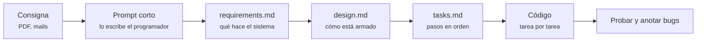

# Clase 11 — Programar mejor con IA: Spec Driven Development

**Fecha:** 29/09/2026 (video subido 30/09/2026)

Video: *"Clase 11 - Programar mejor con IA"*, partes 1, 2 (recreo) y 3. Las partes 2 y 3 no tienen subtítulos en YouTube: este apunte sale de transcribir el audio, que en el recreo tiene pasajes que no se entienden. Material del profesor: `clase-11-ia/` del repo de la cursada (el prompt está en su `README.md`, y los specs que generó la IA en `.kiro/specs/`).

## Qué se dio

- Por qué una clase de IA: "van a codear con IA quieran o no", mejor que sea con criterio
- **Spec Driven Development** (SDD): especificar antes de que nadie escriba código
- Cómo bajar una consigna larga a un prompt corto, por pantallas
- Los tres documentos del spec: `requirements`, `design` y `tasks`
- Ejecutar las tareas, probar, anotar bugs y corregirlos **pasando el contexto justo**
- Un segundo spec para un cambio que llega después (los estilos)
- Gastar poco: modelos baratos o gratis, pocas palabras, lo mecánico a mano

**No entra en el TP.** Lo dijo en la clase 10: "el tema extra de la clase que viene no entra para el TP". El ejemplo fue la consigna vieja del TP 1, la **sala de juegos** (ahorcado, mayor o menor, preguntados, un juego propio, chat y rankings).

---

## 1. La idea

Pegarle la consigna entera a la IA y esperar que resuelva funciona mal: la IA decide todo y se inventa lo que no se le dijo. En SDD el programador **decide primero** y la IA ejecuta:



Cada documento lo genera la IA a partir del anterior, pero **el programador lo lee y lo aprueba** antes de seguir. "La diferencia entre haber pasado el primer prompt y todo lo que hicimos es que yo, como programador, tengo el control de todo lo que va a pasar."

Herramientas que usó: **Kiro** (de Amazon, arma los tres archivos de spec solo) y **Gemini gratis** para comparar. Probó primero Devin (ex Windsurf) y falló. "Las herramientas no son importantes; la idea es que hagamos nosotros bien."

## 2. El prompt: de la consigna a pantallas

La forma más simple de dividir un frontend es **por pantallas (rutas)**. Si se sabe qué pantallas hay, cualquier punto de la consigna cae dentro de alguna.

El prompt del profe (está completo en su `README.md`) es una lista de bloques cortos:

```
Tecnologías: Angular 22. Supabase Auth, DB, Storage y RLS. Usar estándares del archivo AGENTS.md
Rutas: Login, Registro, Home, QuiénSoy, Juego1, Juego2, Juego3, Juego4, Chat, Rankings
Seguridad: Guards para rutas. Los juegos no pueden accederse si no se está logueado. RLS para todo.
Formularios: validaciones de angular, mensajes claros de error, mensaje de éxito formato toastifyjs
DB: Tabla Usuarios. Email unique, username unique. Una tabla de resultados por juego. Relación con usuarios por username.
QuiénSoy: Httpclient.get("https://api.github.com/users/afriadenrich") mostrar datos a modo de ficha.
Juego2 -> Mayor o menor -> Azar -> usar cartas de poker. 3 vidas. Temporizador
```

Lo que remarcó:

- **Pocas palabras.** "Mientras menos se escriba, menos necesita procesar la IA." Lo implícito (si no hay sesión mostrar "Ingresar") no hace falta escribirlo.
- **Si sabés escribirlo en código, escribilo en código.** El `Httpclient.get(...)` del QuiénSoy dice exactamente qué hacer. Y las rutas, en vez de describirlas en castellano, se podían pasar directo como el array de `Routes` con `path`, `component` y `canActivate`.
- **Las decisiones de diseño las toma el humano.** Ejemplo en vivo: los resultados de los juegos. Discutieron una sola tabla normalizada contra una tabla por juego, y relacionar por `id` contra relacionar por `username`. Eligió **una tabla por juego relacionada por `username` único**, para traer el ranking con una sola consulta y no una por fila. "Yo, Agus, el ser humano, lo decidí y lo puedo defender."
- **Lo que no se aclara, la IA lo inventa.** Las reglas de victoria y derrota no las escribió a propósito, y al final fue lo que más falló.
- **AGENTS.md.** El archivo que genera `ng new` cuando se elige configuración de IA trae las reglas de Angular 22 (standalone, `input()`/`output()`, signals, `@Service`, control flow, `host` en vez de `@HostListener`, lazy loading). En el prompt alcanza con "usar estándares del AGENTS.md" en vez de repetirlas.

## 3. Los tres documentos

| Archivo | Qué tiene | Cómo se lee |
| ------- | --------- | ----------- |
| `requirements.md` | Glosario, y un requerimiento por funcionalidad con *user story* y **criterios de aceptación** ("WHEN … THE System SHALL …") | Son **casos de uso**, como en Metodología de Sistemas |
| `design.md` | Arquitectura, capas, rutas, servicios, tablas con sus políticas, estado con signals, manejo de errores, "propiedades" que siempre tienen que cumplirse | Todavía no es código, pero dice qué tiene cada archivo |
| `tasks.md` | Lista ordenada de tareas con checkbox, cada una con los requerimientos que cubre | El orden lo decide la IA: primero infraestructura y auth, después datos, después juegos, al final seguridad, accesibilidad, PWA y tests |

- **Glosario**: define palabras como RLS o Guard para que la IA no las interprete mal ("RLS podría ser cualquier sigla").
- **Revisar lo que la IA agregó por su cuenta**: en los requerimientos apareció un "perfil de usuario" que nadie pidió. Lo borró a mano: "seleccionar y darle a borrar, cero pesos".
- En el diseño apareció `computed()`, y un alumno preguntó qué era. No se da en la cursada; el profe lo explicó así: "es un getter de signal". En vez de guardar un valor, guarda una función que lo calcula a partir de otras signals cada vez que se lee.

## 4. Ejecutar las tareas

Se le pide a la IA que ejecute la tarea 1, después la 2, y así. Lo que pasó:

- **Lo mecánico, mejor a mano.** Instalar paquetes y configurar Tailwind le llevó a la IA más tiempo y créditos que todo lo demás, porque compilaba después de cada cambio. "Eran 5 minutos, por vagos gastamos 5 tokens." Ya en la parte 1 había dicho: "No dejo que la IA instale paquetes. Yo decido qué instalo."
- **El orden importa.** Escribió el archivo de rutas antes de generar los componentes con `ng generate`, y el lazy loading falló.
- **Pedirle que marque las tareas como hechas** le duplicó fases enteras en `tasks.md`.
- **Faltó pedir el SQL** de tablas y políticas. Lo pidió después, lo corrió en el SQL Editor y salieron dos errores de políticas generadas por la IA: faltaba la de `insert`, y otra daba *infinite recursion*. Los encontró él, leyendo el error y la política.
- **Error de diseño que quedó**: crea el usuario en Auth y después la fila en la tabla. Si falla la tabla, el usuario de Auth queda creado igual (el mismo problema de la clase 07).

## 5. Probar y corregir con el contexto justo

La app anduvo a medias. Bugs que anotó en `bugs.md`:

```
- No se puede jugar al mayor menor porque no hay botones.
- La trivia no termina ni envía resultados.
- La batalla naval no coloca barcos de mi lado / no termina nunca / no registra hundidos.
- El guard del login no chequea bien (al recargar te saca).
```

Hay dos formas de corregir:

- **La fácil**: "IA, ayuda, no anda". La IA tiene que recorrer el proyecto, los specs y los archivos para entender de qué se habla, y eso gasta contexto y plata.
- **La del programador**: buscar uno mismo dónde está el problema y pasarle **sólo eso**. Abrir un **chat nuevo** (sin el contexto acumulado), seleccionar el bloque del template con los botones, sumar como contexto el componente y el servicio del juego, y escribir qué pasa en una línea. Gastó 0,07 créditos.

Lo comparó en vivo: el bug de la trivia mandado sin contexto hizo que la IA buscara en archivos que no eran y tocara el juego equivocado. Con el componente y el servicio correctos, lo resolvió.

"Ayuda mucho conocer el proyecto. El programador que está atrás cambia mucho el resultado." Saber que una signal se actualiza sola, o dónde vive cada cosa, viene de haber cursado.

## 6. Un cambio que llega después: otro spec

Los estilos los dejó sin especificar **a propósito**, para mostrar cómo se maneja un cambio posterior: quedó texto blanco sobre fondo blanco y emojis por todos lados. En vez de parchear, hizo un **spec nuevo** (`styling-refactor`): "los estilos están rotos, modificar colores de forma global con esta paleta; reemplazar emojis por íconos". La paleta la sacó de un generador de paletas web. Los colores quedan en un solo archivo de configuración y se cambian ahí.

De paso, **contraste**: en DevTools, con el selector de elementos, el tooltip muestra el ratio de contraste del texto sobre el fondo. Mínimo 3, recomendado 4,5, muy bueno 7. "No me metan texto gris sobre negro."

## 7. Gastar poco

- Modelos baratos o gratis (usó Claude Haiku dentro de Kiro y Gemini gratis). "No aprendan usando los modelos más potentes: son demasiado inventivos." Con uno simple se nota mejor qué hay que especificar.
- Pocas palabras en el prompt y código cuando se puede.
- Chats nuevos para cada bug, con el contexto justo.
- Lo mecánico (instalar, `ng generate`) a mano.

Todo el proyecto le costó unos 20 de los 50 créditos gratis del mes.

## 8. Al margen: pagos en el TP 1

En el recreo un alumno preguntó por el pago de la entrada. Respuesta: **la consigna no pide pagos**. Se pasa de "comprando" a "comprado". Un formulario de tarjeta es opcional; si se hace, validado (el algoritmo de Luhn valida números de tarjeta). "Pueden hacerlo bien o no hacerlo, pero no lo dejen a medias."

---

## Cosas que confunden

| Síntoma | Causa |
| ------- | ----- |
| La IA agrega funcionalidades que nadie pidió | No se revisó `requirements.md` antes de seguir. Hay que borrarlas ahí, no después en el código |
| La lógica de los juegos sale mal | Las reglas (cómo se gana, cómo se pierde) no estaban en el prompt; lo no especificado lo inventa la IA |
| La IA tarda y gasta en instalar o configurar | Lo mecánico conviene hacerlo a mano |
| El lazy loading falla en lo que generó la IA | Escribió las rutas antes de que existieran los componentes |
| Para arreglar un bug la IA toca el archivo equivocado | No se le pasó contexto: hay que darle el archivo y el bloque exactos, en un chat nuevo |
| Las políticas de RLS que generó la IA fallan (falta el `insert`, *infinite recursion*) | Se corrieron sin leerlas. Hay que revisarlas como cualquier SQL |
| Se registra el usuario pero falla la fila en la tabla | Dos operaciones sin rollback, lo mismo que en la clase 07 |

## Referencia rápida

```
1. Prompt corto: tecnologías, rutas, seguridad, formularios, DB y qué hay en cada pantalla
2. IA → requirements.md   → leer y borrar lo inventado
3. IA → design.md         → leer: tablas, servicios, rutas
4. IA → tasks.md          → leer el orden
5. A mano: ng new, npm i, ng generate
6. IA → una tarea por vez → probar
7. Bugs → chat nuevo + el archivo y el bloque exactos + una línea
8. Cambio grande posterior → spec nuevo, no parche
```

## Para practicar

Hay un ejemplo de punta a punta, chico, en [`sdd-mayor-o-menor/`](sdd-mayor-o-menor/): el prompt, los tres documentos y el proyecto en [`../clase-proyecto/`](../clase-proyecto/), hecho tarea por tarea.

## Links

- [Kiro: specs](https://kiro.dev/docs/specs/)
- [Angular: configuración para IA (AGENTS.md)](https://angular.dev/ai/develop-with-ai)
- [Contraste (WebAIM)](https://webaim.org/resources/contrastchecker/)
